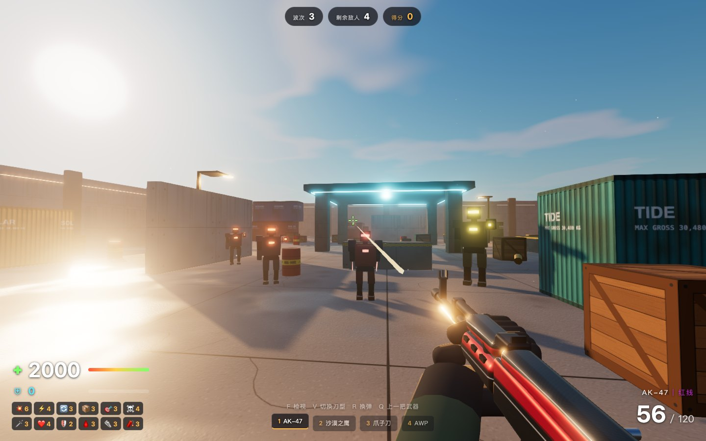
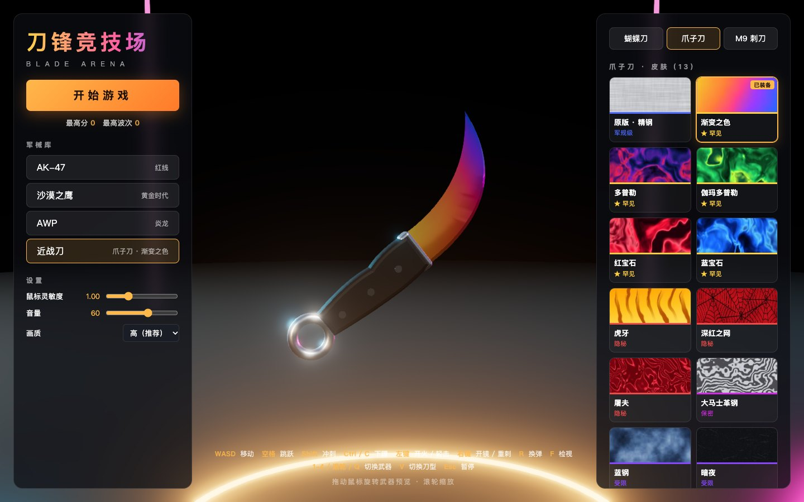
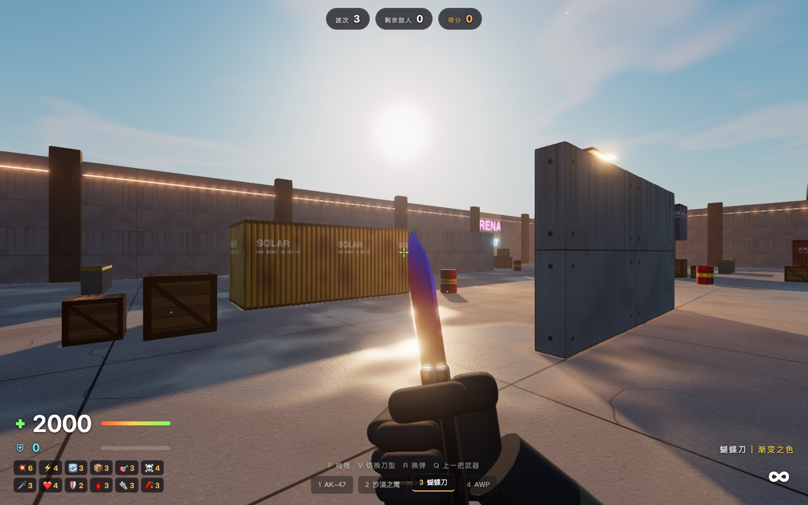

# BLADE ARENA · 刀锋竞技场

A first-person shooter that runs locally in your browser. Download it, double-click `index.html`, and play. Nothing to install, no server, no internet connection needed.

Every model, texture, weapon skin and sound effect is generated by code at runtime. The repository contains no image or audio assets (apart from the screenshots below).

> The in-game interface is in Chinese. The controls table below covers everything you need to play.



| Armory | Inspect |
| --- | --- |
|  |  |

## Getting started

1. Click **Code → Download ZIP** and unzip it, or `git clone` this repository.
2. Open `index.html` in Chrome or Edge. On macOS you can also double-click `启动游戏.command`.
3. Click the orange **开始游戏** (Start) button. The mouse is captured for aiming; press `Esc` to pause.

If the game stutters, lower the quality setting (**画质**) at the bottom of the left panel in the main menu.

## Features

- **Three knives**: Butterfly Knife, Karambit and M9 Bayonet, each with its own draw, slash, heavy attack and inspect animation
- **Three guns**: AK-47 (full auto), Desert Eagle, and AWP (scoped, pierces multiple enemies)
- **Skins**: 10 for guns and 13 for knives. Preview and equip them in the armory on the main menu; your choice is saved automatically
- **Lighting**: low sunset sun with real-time soft shadows, bloom, neon and street lamps, and environment reflections on metal. Step into shade and the weapon in your hands darkens too
- **Grenades**: press `G` for a quick throw. Three per wave; they bounce off walls and the floor and go off after 1.7 s
- **Enemies**: robot infantry, rushers and heavies, with a boss on wave 5
- **Also**: explosive barrels, pickups that fly to you, kill-streak multipliers, and bonus score for headshots, knife kills and backstabs

## Controls

| Key | Action |
| --- | --- |
| `W` `A` `S` `D` | Move |
| `Space` / `Shift` / `Ctrl` or `C` | Jump / sprint / crouch |
| Left mouse | Fire. With a knife: horizontal slash (hold to chain forehand and backhand) |
| Right mouse | AWP scope. With a knife: heavy attack (from behind it is an instant-kill backstab) |
| `R` / `F` | Reload / inspect weapon |
| `G` | Throw a grenade (3 per wave, refilled at the start of each wave) |
| `1` `2` `3` `4`, mouse wheel, `Q` | AK-47 / Desert Eagle / knife / AWP. `Q` switches back to the previous weapon |
| `V` | Cycle knife type during a match |
| `Esc` | Pause |

## Gameplay

Wave survival over 5 waves. Defeat the boss on wave 5 to win.

Pick a difficulty (**难度**) in the settings on the left of the main menu:

| Difficulty | Perks | Enemies |
| --- | --- | --- |
| Casual (爽玩, default) | All 12 perks at max level from the start, so health is 2000 | Normal damage |
| Normal (普通) | Choose one perk card after each wave | Damage ×4 |
| Hard (困难) | Choose one perk card after each wave | Health ×1.35, damage ×7 |

Base health is 1000 on every difficulty. The tiers are defined in `src/difficulty.js` if you want to tune them.

## How it works

- **Rendering**: [three.js](https://threejs.org/) with bloom and FXAA post-processing and ACES tone mapping
- **Models**: assembled in code from primitives, extrusions and lofted blades (`src/models.js`)
- **Skins and world textures**: drawn on canvas using value noise and Voronoi patterns (`src/skins.js`, `src/world.js`)
- **Audio**: synthesised live with WebAudio from noise, oscillators and a convolution reverb (`src/audio.js`)
- **Enemy pathfinding**: a flow field on a 1 m grid, recomputed from the player's position every 0.12 s

```
src/
  main.js      game loop, waves, combat resolution, pickups
  world.js     sky, lighting, map, collision, navigation
  player.js    movement, camera, recoil, damage
  weapons.js   first-person view models, all weapon animation, shooting logic
  models.js    procedural guns, knives and arms
  skins.js     skin textures
  enemies.js   enemy AI, energy bolts, boss
  grenade.js   grenade throw animation, bounce physics, fuse
  fx.js        particles, tracers, bullet holes, explosions
  audio.js     sound synthesis
  ui.js        HUD and menus
  showcase.js  the 3D armory stage
```

## Development

`dist/game.js` is the bundled build and is committed to the repository, which is why the game runs straight from a download. After editing anything in `src/`, rebuild it:

```
npm install      # once
npm run build    # writes dist/game.js
npm run dev      # or: rebuild automatically on change
```

Opening `index.html?debug` turns off pointer lock and the automatic game loop, so you can step the game frame by frame from the console with `__game.step(1/60)`. This is handy when tuning animations.

## Feedback welcome

This project is still being tuned as it goes. Game feel, animation, balance and visuals all have room to improve, and suggestions are very welcome.

- If something feels off, an animation looks awkward, performance is poor, or you have an idea for a weapon, skin or mode, please open an [Issue](../../issues)
- For game-feel reports, say which weapon and which action you mean (for example "Karambit, second left-click slash"). A screen recording helps a lot
- Pull requests are welcome too
- Issues in Chinese or English are both fine

## Disclaimer

This is a personal hobby project and is not affiliated with Valve or any commercial game. Weapon and skin names are used as a tribute; all models and textures are original and generated by this project's code.

---

**中文简介**：打开 `index.html` 就能玩的浏览器 FPS，包含蝴蝶刀、爪子刀、M9 刺刀的检视动作，以及武器皮肤和实时光影，所有模型、贴图、音效均由代码生成。欢迎在 [Issues](../../issues) 里用中文提意见。
